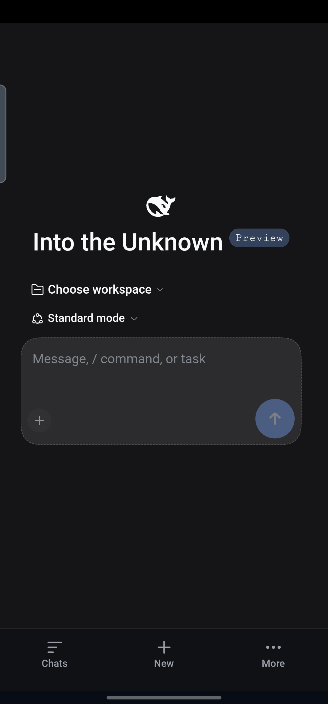
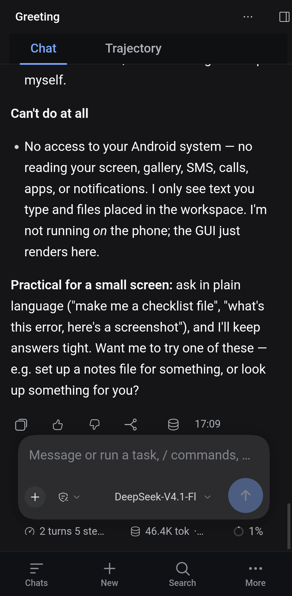
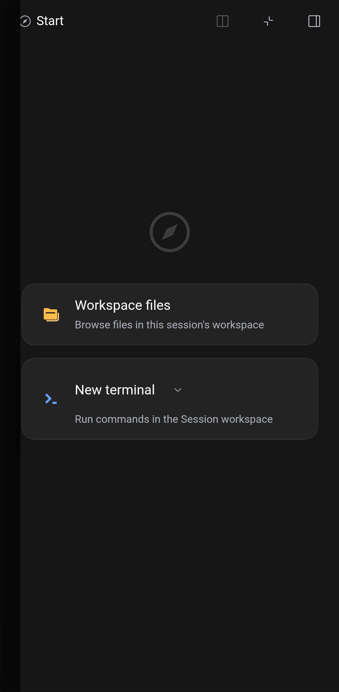
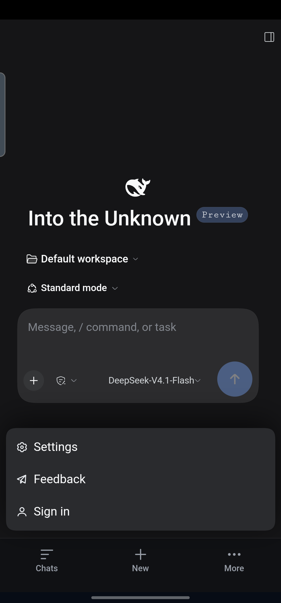
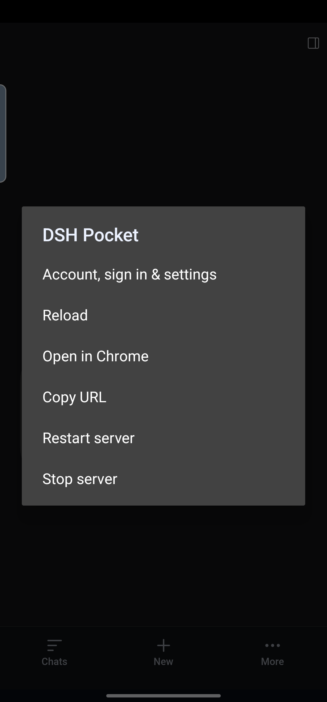

# DSH Pocket

[](https://github.com/mhzsajan/dsh-pocket/actions/workflows/build-ui.yml)

**DeepSeek Harness (dsh) on your Android phone — one self-contained APK, no PC, no
Termux app, no root.**

DSH Pocket embeds a real Linux userland (Ubuntu 24.04 arm64 + Node.js 22 + `dsh`) and
runs it under **PRoot** inside the app, then shows the DSH web UI in a full-screen
WebView with a phone-first UI shell (bottom navigation, drawers, bottom-sheet menus,
thumb-sized controls).

<sub>Keywords: DeepSeek Harness on Android · DSH mobile app · PRoot Ubuntu on Android ·
Termux alternative · run an AI coding agent on your phone without root · on-device
Linux for Android · arm64 sideload APK.</sub>

| | |
|---|---|
| Package | `com.dshpocket` · label **DSH Pocket** |
| SDK | minSdk **26** (Android 8) · targetSdk **28** (deliberate — legacy app domain may `execve` files from app data, same trick Termux uses) |
| ABI | **arm64-v8a** (the embedded Linux runtime is aarch64) |
| APK | ~314 MB, debug-signed with the committed `keystore/debug.keystore` |
| Host | Windows + PowerShell, Android SDK build-tools 36 + `platforms/android-35`, JDK 21 — **no Gradle, no AndroidX** |




| Right panel (drawer) | Account / settings sheet | Native More menu |
|---|---|---|
|  |  |  |

## What it does

* **First launch** extracts the embedded Linux runtime into app-private storage
  (72 k files / 1.09 GB, ~15 s), starts `dsh web --host 127.0.0.1 --port 0`, parses the
  printed token URL and opens the real DSH UI. Cold launch → usable UI ≈ 50 s.
* **After that** it boots in a few seconds; a foreground service + wake lock keep the
  server alive while backgrounded, with a notification (Stop / Open).
* The guest has `git`, `curl`, `unzip`, `xz`, `less`, `nano`, `xdg-user-dirs`, a working
  `apt` (IPv4-forced) and `npm` — the agent can install whatever it needs.
* The phone's shared storage is mounted at `/sdcard` inside the guest (when the storage
  permission is granted); the default workspace lives in the app's private Linux fs.
* `dsh` is pinned to `0.2.1-rc.2`; native deps (`koffi`, `node-pty`) come from arm64
  prebuilts — no compilation ever happens on the phone.

## Install (no PC needed)

1. Copy `dist/DSH-Pocket.apk` to the phone (USB / Drive / Telegram — not WhatsApp, 100 MB cap).
2. Tap it → allow *install unknown apps* → install anyway (the "older Android" warning is expected).
3. Open **DSH Pocket** → allow storage → wait for "Server ready" (~1 min first time).
4. In the DSH UI: **Choose workspace → Default workspace**, then **Get started → Add API Key**
   (or sign in), and start working.

Phone must be **arm64, Android 8+, ~2.3 GB free**. Full guide (including Play Protect
warnings, updates and troubleshooting): [docs/INSTALL-OTHER-PHONES.md](docs/INSTALL-OTHER-PHONES.md).

## Build from source

```powershell
# 1) fetch the small third-party runtime binaries (proot, loader, libtalloc, libandroid-shmem)
pwsh -File runtime/fetch-assets.ps1

# 2) provide runtime/rootfs.tar.gz (build once on an arm64 machine — see runtime/README.md)
#    plus runtime/start-dsh.sh (committed)

# 3) build the APK (and optionally install/launch on a connected phone)
pwsh -File dsh-pocket/build.ps1
pwsh -File dsh-pocket/build.ps1 -Install -Launch -AdbSerial <serial>
```

`build.ps1` drives `aapt2 → javac → d8 → zip → zipalign → apksigner` and fails loudly
unless the runtime assets are present (use `-AllowIncompleteRuntime` for UI-only work,
or `-RuntimeSource <dir>` for the mock runtime fixture).

Signing key: `keystore/debug.keystore` (`storepass`/`keypass` = `android`, alias
`androiddebugkey`). It is committed on purpose so every build — and every phone — keeps
the same signature and can update in place.

## How it works (short version)

```
MainActivity ──auto-start──> DshService (foreground)
                               │ 1. extract assets/runtime/* → files/ (proot, loader, lib/, rootfs/)
                               │ 2. exec:  files/proot -0 -l -r files/rootfs \
                               │              -b /dev -b /proc -b /sys \
                               │              -b files/workspace:/root/workspace \
                               │              [-b /storage/emulated/0:/sdcard] \
                               │              -w /root /bin/bash /root/start-dsh.sh
                               │ 3. parse "DSH_READY http://127.0.0.1:<port>/?token=…"
                               └â–º WebActivity: WebView loads that token URL
                                  + injects app/assets/mobile/skin.{css,js} (phone UI)
```

The dsh web UI is desktop-first, so the app injects a **phone shell**: no permanent
icon rail, overlay drawers for the sidebar/right panel, bottom-sheet popovers, sticky
close buttons, 40–48 px targets, keyboard-aware composer and a 3-item bottom nav
(Chats / New / More → native menu). Details and selectors: [ARCHITECTURE.md](ARCHITECTURE.md),
[docs/DEV-WORKFLOW.md](docs/DEV-WORKFLOW.md).

## Repository layout

```
dsh-pocket/
  build.ps1                 # hand-written APK build (aapt2/javac/d8/zipalign/apksigner)
  ARCHITECTURE.md           # binding design contract (runtime layout, launch contract)
  README.md · CHANGELOG.md · LICENSE · THIRD-PARTY.md
  keystore/debug.keystore   # committed debug key → updates work across builds
  app/
    AndroidManifest.xml
    res/                    # dark theme, icon, notification drawable
    src/com/dshpocket/
      MainActivity.java     # launcher: status, onboarding, device info, Open/Restart/Stop, log
      WebActivity.java      # WebView + skin injection + native menu + file chooser
      DshService.java       # foreground service: install runtime, spawn proot, parse URL
      RuntimeInstaller.java # asset staging, ustar reader, progress, version marker
      DshState.java · DshLog.java · Prefs.java · ExecProbe.java
    assets/mobile/          # skin.css + skin.js (phone shell injected into the web UI)
    assets/probe/           # self-test payloads (static arm64 ELF, toybox)
    tools/                  # icon/probe/mock-runtime generators
  runtime/
    start-dsh.sh            # guest entrypoint: dsh web → prints DSH_READY
    fetch-assets.ps1        # downloads/verifies proot+loader+libs (and rootfs build inputs)
    extract-deb.py          # stdlib .deb (ar) extractor used by fetch-assets
    README.md               # how to rebuild rootfs.tar.gz on arm64
    notes-runtime.md        # every device-level gotcha verified on the phone
  tools/                    # cdp.mjs (DevTools client), e2e.ps1, final-e2e.ps1, shots.ps1
  docs/
    INSTALL-OTHER-PHONES.md # universal install/update/troubleshooting guide
    DEV-WORKFLOW.md         # build→phone→inspect loop, live skin injection
    screenshots/            # UI screenshots (PII-free)
  notes/                    # dsh-cli.md (token/URL contract), mobile-ui-audit.md
```

Large binaries are **not** committed: `runtime/{proot,loader,lib/,rootfs.tar.gz}` and
`app/assets/runtime/` are generated (`.gitignore`). See [runtime/README.md](runtime/README.md).

## Status / roadmap

Working: cold/warm start, DSH web UI + phone shell, workspace selection, `/sdcard`
access, foreground service, battery/wakelock, self-test, log capture, update-in-place.

Next:

- [ ] Settings sub-page: fully stacked single-column rows (still desktop 2-column-ish)
- [ ] Trajectory view: denser phone layout; wrap filter row
- [ ] Optional built-in terminal tab (xterm + PTY) instead of the DSH panel terminal
- [ ] x86_64 runtime variant (emulators/Chromebooks) — separate rootfs + proot build
- [x] CI: UI-only APK build on every push (`.github/workflows/build-ui.yml`)
- [x] Distribute the APK via GitHub Releases (v1.14 asset)

## Privacy & security

* **No telemetry** — no analytics, crash uploaders or tracking SDKs. Network traffic is
  DSH's own (DeepSeek API / sign-in) plus any package manager you run in the guest.
* **Data stays on the phone** — sessions, API key, workspace and the Linux runtime live in
  the app's private storage; the local dsh server binds `127.0.0.1` with a per-run token.
  `/sdcard` is only exposed inside the guest after you grant the storage permission.
* **Repository hygiene** — no device serials, home-directory paths, personal data or
  PII-containing screenshots are committed; the committed keystore is a public debug key.
* **Signing** — debug-signed so updates install in place. Because that key is public,
  only install builds from this repository's releases; for stronger guarantees, build
  with your own private keystore. Details: [SECURITY.md](SECURITY.md).

## License

MIT — see [LICENSE](LICENSE). The **built APK** also contains third-party components
(PRoot is GPL-2.0-or-later, Ubuntu base, Node.js, DSH); redistribution obligations are
summarised in [THIRD-PARTY.md](THIRD-PARTY.md).

